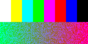
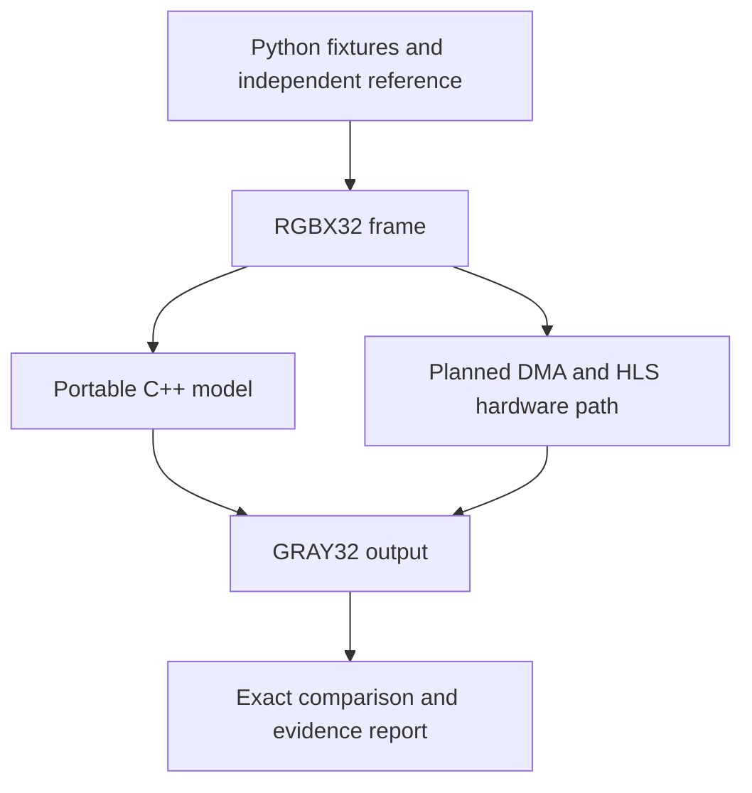

# KV260 FPGA Image Processing

[](https://github.com/Davorin51/KV260-FPGA-Image-Processing/actions/workflows/host.yml)


Original classical image-processing kernels and verification tools targeting the AMD Kria KV260.
Built incrementally: a working, bit-exact RGB-to-grayscale software milestone, with an AXI4-Stream
HLS wrapper ready for validation on an installed AMD toolchain.

**Current status:** CPU verification works. AMD C simulation, synthesis, RTL co-simulation and
KV260 board execution have **not** been run. There is no bitstream or measured FPGA performance.
No neural networks, inference engines or proprietary university/employer source are included.

## Actual demonstration

Deterministic synthetic RGB input and the C++ CPU output, checked against an independent NumPy
reference. These are real generated images, not screenshots of FPGA execution.

| Input | Grayscale CPU output |
| --- | --- |
|  |  |

The checked-in 128×64 example contains **8,192 pixels, zero differing pixels and MSE 0**.
PSNR is infinite for an exact match; JSON represents this as `psnr_db: null` and
`psnr_infinite: true`, avoiding nonstandard JSON infinity values.
Inspect the [JSON evidence](examples/grayscale-demo/report.json),
[CSV comparison](examples/grayscale-demo/comparison.csv), or download
[the HTML report](examples/grayscale-demo/report.html) with its neighboring PNG files.
Reproduce it locally with the commands below. No hardware speed is inferred from this result.

## First milestone

| Component | Status |
| --- | --- |
| RGB-to-grayscale integer core | Implemented; portable C++ and independent Python checks |
| CPU frame transport, raw image conversion, MSE/PSNR comparison | Implemented |
| Deterministic fixtures and JSON/CSV/HTML report | Implemented |
| AXI4-Stream/AXI4-Lite wrapper and vendor-header testbench | Source provided; AMD validation pending |
| DMA/block-design integration | Interface and integration guide; hardware implementation pending |
| Sobel, Gaussian 3×3/5×5, sharpening, threshold, convolution | Future milestones |
| Morphology, HLS report extraction, resource plots, PDF reports | Future work |

## Quick start without FPGA hardware

Requires Python 3.11+, a C++14 compiler and GNU Make. Linux is the verified host environment.

```bash
git clone https://github.com/Davorin51/KV260-FPGA-Image-Processing.git
cd KV260-FPGA-Image-Processing
python3 -m venv .venv
source .venv/bin/activate
pip install -r requirements-dev.lock
pip install --no-deps -e .
make test
make lint
make demo
```

`make demo` writes a **new** `build/demo/` directory with input/reference/CPU/difference PNGs,
raw buffers, JSON, CSV and HTML. To preserve earlier evidence, demo refuses an existing output
directory. For another run choose a fresh directory:

```bash
python -m kv260_image demo --cpp build/grayscale_cpu --output build/demo-second --rows 64 --cols 128
python -m kv260_image gray examples/grayscale-demo/input.png --output build/reference.png
python -m kv260_image --help
```

The installed `kv260-image` command exposes the same interface. Python utilities operate
without AMD headers. The C++ binary is explicitly a CPU model, not a board driver.

## Architecture and numerical contract



`Y = (77*R + 150*G + 29*B + 128) / 256`, using unsigned integer division.
Input is one RGBX32 word per pixel; output is one GRAY32 word per pixel with grayscale in
the low byte and zero padding. Project dimension bounds are 1–1080 rows and 1–1920 columns;
these are selected design limits, not demonstrated device capacity.

The proposed DMA path uses **frame-final TLAST**, not video end-of-line TLAST. Do not connect
this interface directly to AXI4-Stream Video without a framing adapter. The HLS wrapper uses
AMD `ap_axiu` types; portable frame tests do not substitute for vendor C simulation.
Read the [interface contract](docs/interface.md) and [architecture](docs/architecture.md)
for qualifiers, diagnostic status, framing failure modes and memory layout.

## AMD tools and board integration

```bash
python scripts/inspect_environment.py --help
python scripts/run_hls.py --help
```

Use the [KV260 setup guide](docs/kv260_setup.md) to discover installed board/part names and
choose the actual clock constraint. Supply `HLS_PART` and `HLS_CLOCK_NS` from that environment
before invoking `make hls-csim`. The runner fails explicitly when AMD tools are absent.
No clock frequency, AXI address, board preset or synthesis result is guessed here.

## Verification

The first authoring run passed **30 pytest tests**, **97.74% Python host coverage**, and
exhaustive C++ arithmetic checks of all **16,777,216 RGB values**. Cross-language tests include
random images up to 1920×1080, Hypothesis properties, malformed inputs and frame diagnostics.
These are software results; see the [verification record](docs/verification.md) for scope.

```bash
make test          # strict C++ build, C++ tests, pytest; minimum host coverage 85%
make lint          # Ruff lint and formatting
make sanitize      # AddressSanitizer + UndefinedBehaviorSanitizer
python -m build    # Python source distribution and wheel
```

GitHub Actions runs host checks on Python 3.11, 3.12 and 3.13 and uploads freshly generated
CPU demo artifacts. It does not run licensed AMD tools or board tests.

## Repository map

- `hls/`: original grayscale core, actual AMD stream wrapper.
- `host/cpp/`: CPU-only binary and memory transport.
- `host/python/`: independent numerical reference, formats, metrics and CLI.
- `tests/`: C++ portable tests, AMD testbench and Python cross-language tests.
- `scripts/`: explicit environment inspection and optional HLS flow.
- `examples/`: reproducible synthetic images and actual software comparison.
- `benchmarks/`: authoring environment record; no invented FPGA measurements.
- `docs/`: architecture, framing, deployment, verification and performance methodology.

## Troubleshooting

- **AMD tools missing:** host tests still work. HLS execution exits with a clear error.
- **Demo output already exists:** use a new output directory to retain previous evidence.
- **Frame hangs on hardware:** missing beats/early TLAST may block the IP; integration needs
  bounded host waits and DMA/IP recovery. A status register is not a stream watchdog.
- **Wrong grayscale values:** check RGB byte order, zero output padding and integer rounding.
- **DMA rejects a frame:** verify the generated buffer-length capacity and transfer byte count;
  start with a small frame and use the actual generated register map.
- **Sanitizer under process supervision:** LeakSanitizer may be blocked by ptrace/proc restrictions.
  See the verification record for the limited local workaround and its scope.

## Next milestone and license

Next: validate AMD C simulation, inspect synthesis scheduling/resources, co-simulate, then
integrate a small DMA frame on the actual KV260. Only after this interface is verified, add
Sobel with an explicit border policy and line-buffer tests. See [ROADMAP](ROADMAP.md).

[MIT](LICENSE) covers the original source in this repository. AMD toolchains/headers are
external dependencies under their own terms. See [provenance](docs/provenance.md).
