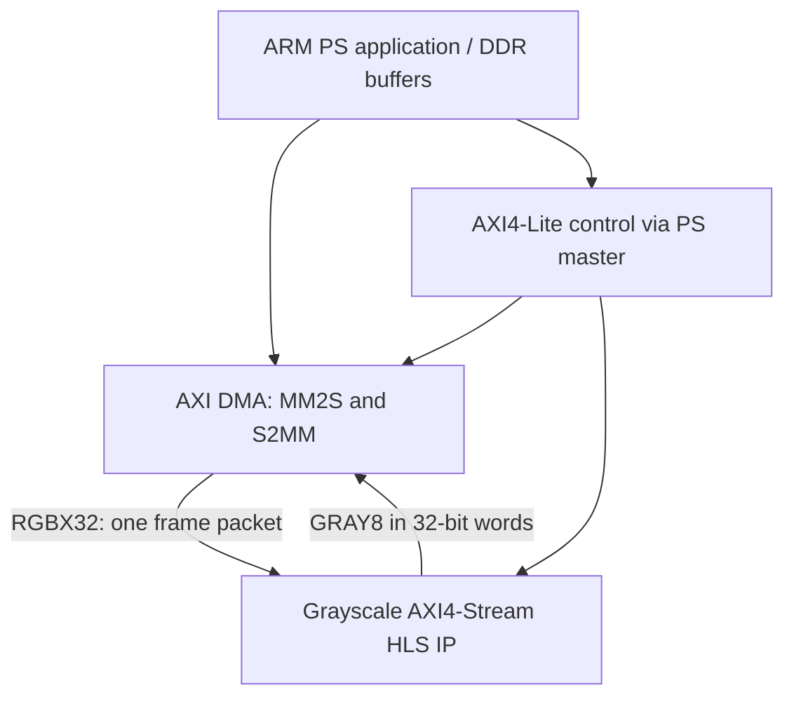

# Architecture

## Proposed KV260 integration (not built yet)

The HLS point kernel is portable between compatible devices; PS/DDR presets, the target
part, clocks, reset wiring and addresses are board-specific. A ZCU104 design is not a
KV260 bitstream and must not be presented as one. AMD UG1089 documents the K26 board flow.

## M1 implementation boundary

- `hls/include/`: fixed-point arithmetic and a transport-independent frame loop.
- `hls/grayscale/`: an AMD-header AXI adapter; vendor compilation remains to be verified.
- `host/cpp/`: a software-only binary processor using the portable frame model.
- `host/python/`: an independent NumPy reference, fixture/packing/comparison utilities.
- `tests/`: actual portable C++ and cross-language numerical tests; separate vendor testbench.
- `scripts/`: explicit environment inspection and optional AMD runs.

The C++ transport used by portable tests is an in-memory software model. It is NOT an
emulation of AMD headers or an RTL protocol simulation. No fake `ap_uint`/`hls::stream`
headers are provided. Passing GCC tests does not establish HLS synthesizability or timing.

## Streaming design

One pixel per 32-bit transfer preserves identical input/output DMA beat widths and uses
all four byte lanes. Grayscale occupies the output's low byte; its three padding bytes
are zero. This deliberately spends four bytes per gray pixel to simplify the first DMA
contract. A compact 8-bit transport is a later optimization requiring its own integration
and packing verification. No DMA bandwidth or FPS result is inferred from this decision.

Grayscale is stateless point processing, so it needs neither line buffers nor frame
storage in the synthesizable loop. Adding buffers or DATAFLOW here without evidence
would not improve this milestone. Sobel will introduce two line buffers and a sliding
window only after the board interface is validated.

Dimensions are runtime AXI4-Lite parameters. Project bounds are 1920 columns by 1080 rows;
these are selected software/design bounds, not a claim about board limits or supported
camera modes. The source requests II=1. Actual II, latency and mapped resources are unknown.
